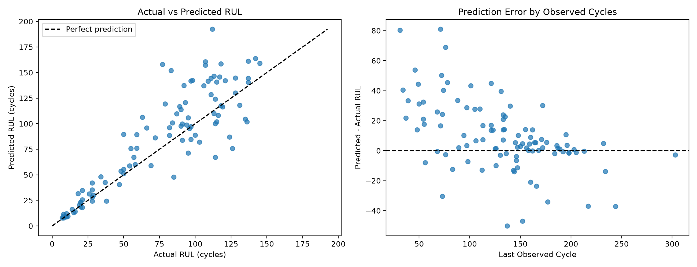
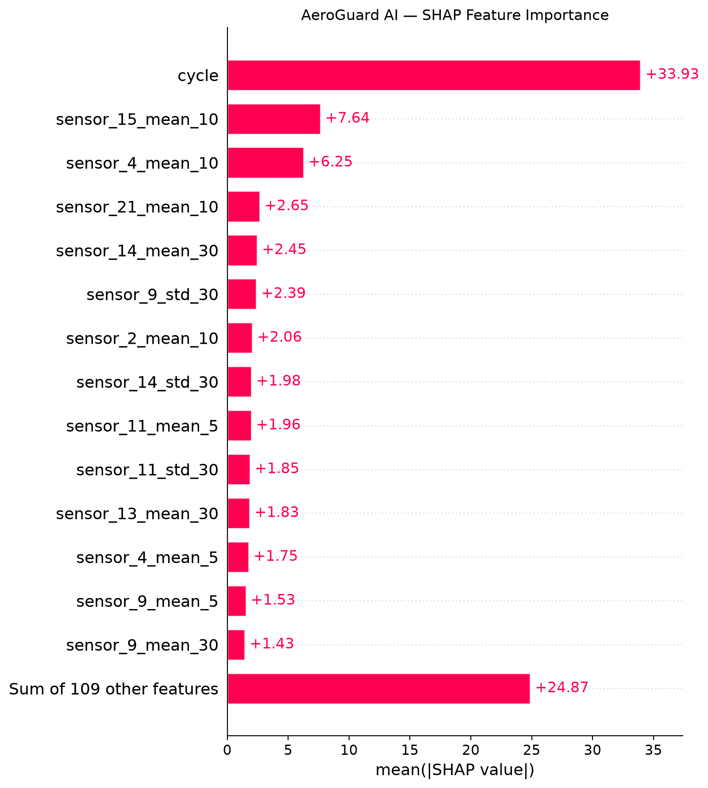

# AeroGuard AI

### AI-Powered Predictive Maintenance & Remaining Useful Life Prediction

AeroGuard AI is an end-to-end **machine learning + web application** that estimates the **Remaining Useful Life (RUL)** of simulated turbofan engines using the **NASA C-MAPSS FD001** dataset. It combines an experimentally evaluated Random Forest regression model, a **FastAPI inference service**, and a **React dashboard** for prediction, analytics, and engine-history exploration.

> **Research / educational demonstration.** NASA C-MAPSS contains simulated data. This system is **not certified or validated for actual aircraft maintenance decisions**. The model sometimes overestimates RUL.

## Features

- **RUL prediction:** Upload FD001-style whitespace-separated `.txt` or header-based `.csv` sensor history, select an engine, and request an estimate in operating cycles.
- **Fleet explorer:** Browse 100 simulated FD001 test engines, search by engine ID, inspect historical sensor readings, and predict RUL for a selected engine.
- **Model analytics:** Interactive actual-vs-predicted charts, signed-error visualization, lifecycle validation results, and global SHAP feature importance.
- **REST API:** Endpoints for health checks, model metadata, inference, analytics, engine listing, and sensor history, with interactive Swagger documentation.
- **Validation:** Group-aware development validation, official NASA FD001 test benchmark, model-inference tests, and API tests.

## Tech Stack

| Layer | Technologies |
| --- | --- |
| ML / data | Python, NumPy, Pandas, scikit-learn, XGBoost, SHAP |
| Visualization / experiments | Matplotlib, Seaborn, Jupyter |
| ML serving | FastAPI, Pydantic, Uvicorn |
| Frontend | React, Vite, Tailwind CSS v4, Recharts, Lucide React, Papa Parse |
| Testing | Python `unittest`, FastAPI `TestClient`, HTTPX, Vite build |
| Planned persistence | Express.js, Node.js, MongoDB — **not implemented yet** |

## Dataset

The project uses **NASA C-MAPSS FD001** (one operating condition and one fault mode). The local FD001 files are:

| File | Purpose |
| --- | --- |
| `train_FD001.txt` | Complete engine histories used for training (100 engines; 20,631 records) |
| `test_FD001.txt` | Partial observed histories for independent evaluation/demo (100 engines; 13,096 records) |
| `RUL_FD001.txt` | Actual RUL at the last observed cycle for each official test engine |

Each input record has **26 columns**: engine ID, operating cycle, three operating settings, and 21 sensors. The model uses **123 engineered input features**, derived from 15 variable sensors, cycle/operating information, and past-only rolling statistics and deltas.

**Dataset source:** [NASA Prognostics Center of Excellence — data repository](https://www.nasa.gov/intelligent-systems-division/discovery-and-systems-health/pcoe/pcoe-data-set-repository/).

Raw and processed datasets are **not tracked in Git**. Download the NASA C-MAPSS dataset separately and place the FD001 files in:

```text
data/raw/train_FD001.txt
data/raw/test_FD001.txt
data/raw/RUL_FD001.txt
```

The official test RUL labels are used **only for evaluation**; they are not passed to the inference API.

## Model & Evaluation

The project compared a mean baseline, Ridge Regression, Random Forest, and XGBoost. It used an engine-grouped train/validation split, retrospective partial-history snapshots, and 3-fold GroupKFold optimization on training engines. **RF_B**, a Random Forest regressor, was selected before final test evaluation.

**Final RF_B parameters:** `n_estimators=160`, `max_depth=18`, `min_samples_leaf=5`, `max_features=0.8`, `random_state=42`.

### Official NASA FD001 test results

These figures are computed for the **100 official test engines**, with one RUL prediction per engine at its last observed cycle.

| Metric | Result |
| --- | ---: |
| Mean Absolute Error (MAE) | **17.7685 cycles** |
| Root Mean Squared Error (RMSE) | **25.1574 cycles** |
| Mean signed error (prediction − actual) | **+9.5634 cycles** |
| Engines with overestimated RUL | **69 / 100** |
| Engines with underestimated RUL | **31 / 100** |

**Interpretation:** The model has a noticeable tendency to overestimate remaining life. Some early-history predictions have large errors. The benchmark does **not** establish reliability for real-world maintenance.

### Development-validation context

On 60 retrospective snapshots (20 validation engines at 50%, 70%, and 90% of their known full lifetimes), optimized RF_B achieved **MAE 14.2934** and **RMSE 21.7156** cycles. Snapshot positions are determined retrospectively using true lifetimes and are **not** an online lifecycle detector. Those results should not be confused with the official independent test benchmark above.

### Evaluation visualizations





Global SHAP importance is calculated from **40 sampled training records**; importance explains the model's prediction behavior, not causal engine physics. Operating cycle is the most influential feature in that sample.

For complete numeric evidence, see [`ml/reports/`](ml/reports/) and the experiment notebooks in [`notebooks/`](notebooks/).

## Repository Structure

```text
.
├── data/                      # Raw/processed data placeholders; datasets ignored by Git
├── docs/                      # Validation notes, feature names, test logs, environments
├── frontend/                  # React + Vite + Tailwind dashboard
│   └── src/components/        # RULPrediction, ModelAnalytics, EngineFleet
├── ml/
│   ├── artifacts/             # Local trained model, ignored by Git
│   ├── reports/               # Results, CSVs, figures, metrics JSON
│   └── src/aeroguard_ml/      # Loader, feature engineering, prediction
├── notebooks/                 # EDA, training, tuning, holdout, testing, SHAP
├── scripts/                   # Local API smoke test
├── services/inference_api/    # FastAPI routes and server
├── tests/api/                 # API tests
├── tests/ml/                  # Model inference tests
├── requirements.txt           # Direct Python dependencies
└── README.md
```

## Getting Started (Windows / PowerShell)

**Prerequisites:** Python 3.13, Node.js 24 (or a compatible supported LTS), npm, and the NASA FD001 data files listed above.

### 1. Clone the repository

```powershell
git clone https://github.com/ehaab212/AeroGuard-AI-Predictive-Maintenance.git
cd AeroGuard-AI-Predictive-Maintenance
```

### 2. Set up Python dependencies

```powershell
python -m venv .venv
.\.venv\Scripts\Activate.ps1
python -m pip install -r requirements.txt
```

> Keep `requirements.txt` updated with the project's direct runtime/analysis dependencies, including **joblib, XGBoost, SHAP, FastAPI, Uvicorn, and HTTPX**. A full environment snapshot is available in `docs/environment-packages.txt`; versions may vary by machine.

### 3. Prepare the saved ML model

The model file `ml/artifacts/aeroguard_rf_b_v1.joblib` is intentionally **excluded from Git**. To reproduce it, add the FD001 raw files and execute `notebooks/05_final_model_evaluation.ipynb` after preparing the training/features workflow. It saves the model package locally for FastAPI. Earlier experiment notebooks document preprocessing, feature selection, model comparisons and tuning.

**Do not load untrusted `.joblib` files:** Python model deserialization may execute code.

### 4. Run FastAPI (terminal 1, repository root)

```powershell
python -m uvicorn services.inference_api.main:app --reload --reload-dir services --host 127.0.0.1 --port 8000
```

API documentation: **http://127.0.0.1:8000/docs**

### 5. Run the React dashboard (terminal 2)

```powershell
cd frontend
npm install
npm run dev
```

Open the local address printed by Vite (usually **http://localhost:5173/**). The Vite development proxy forwards `/api/*` requests to FastAPI on port 8000. Both servers need to be running for model-backed features.

### 6. Create a frontend production build

```powershell
cd frontend
npm run build
```

The build outputs static assets to `frontend/dist/` (not committed). Building the frontend does not deploy the Python inference service.

## API Endpoints

| Method | Route | Description |
| --- | --- | --- |
| `GET` | `/health` | API/model readiness |
| `GET` | `/model/info` | Model version, feature count and metadata |
| `POST` | `/predict/rul` | Estimate RUL from **one engine's ordered sensor history** |
| `GET` | `/analytics/summary` | Official benchmark, SHAP and lifecycle charts data |
| `GET` | `/fleet/engines` | Simulated FD001 test engine directory |
| `GET` | `/fleet/engines/{engine_id}/history` | Raw observed sensor history for one engine |

`POST /predict/rul` accepts a JSON object with a `records` array, where each record includes `engine_id`, `cycle`, `setting_1`–`setting_3`, and `sensor_1`–`sensor_21`. The current inference contract requires one engine, consecutive nonduplicate cycles, numeric finite inputs, and at most 500 records per request. Interactive schemas and examples are available via Swagger.

The engine-history and analytics endpoints require the appropriate local raw/report files; they are **read-only** views over simulated data.

## Tests

Run from the repository root with the Python virtual environment active:

```powershell
python -m unittest discover -s tests/ml -p "test_inference.py" -v
python -m unittest discover -s tests/api -p "test_api.py" -v
```

During local development, **5 inference tests and 8 API tests passed**. The initial API suite covers health, metadata, valid predictions, consistency with direct inference, and input validation. Analytics and fleet routes should receive dedicated automated tests as the project evolves.

For a live HTTP smoke test, start FastAPI and run:

```powershell
python scripts/test_api_local.py
```

## Current Status & Roadmap

- [x] Dataset exploration, validation, engine-separated development splits
- [x] Causal rolling-window feature engineering and model comparison
- [x] Cross-validation optimization and final NASA FD001 evaluation
- [x] SHAP explanation and prediction error analysis
- [x] Local model package and FastAPI inference endpoints
- [x] React overview, CSV/TXT RUL prediction, analytics, and fleet exploration
- [x] Basic automated ML inference and API tests
- [ ] Broader integration tests, production configuration and deployment
- [ ] Persistent prediction records, Express.js / Node.js, and MongoDB
- [ ] Authentication, observability and production hardening (if deployed)

## Limitations

- NASA FD001 is a simulated research dataset, **not live aircraft telemetry**.
- The model is trained/evaluated on FD001 and has not been validated on other fault modes or real engines.
- Positive mean bias and some large individual errors make operational use inappropriate.
- Model binary and raw dataset are excluded from Git; a fresh clone needs local data and model reproduction.
- Fleet browsing currently reads test data from local files; it is not a persisted operational fleet database.

## Author

**Ehaab Ullah** · [GitHub](https://github.com/ehaab212)

## Acknowledgements

NASA Prognostics Center of Excellence for publishing the C-MAPSS simulated turbofan engine degradation datasets.
